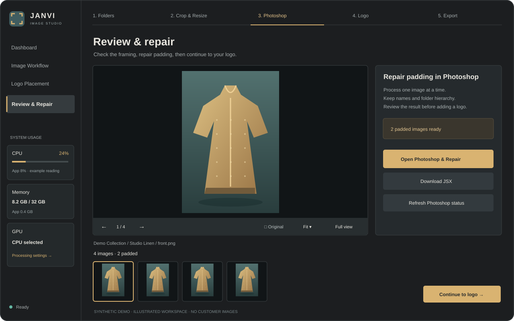
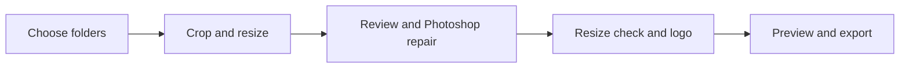

<div align="center">


# Janvi Image Studio

**Prepare product images. Keep the subject. Finish the collection.**

<sub>Built for Buzl.</sub>

A Windows desktop workspace for subject-aware resizing, Photoshop padding repair,
logo placement, and organised Shopify image exports.

[](https://github.com/mahe-pkm/JANVI_IMAGE_RESIZE/releases/latest)


[Download](https://github.com/mahe-pkm/JANVI_IMAGE_RESIZE/releases/latest) ·
[Quick start](#quick-start) · [Installation](docs/INSTALLATION.md) · [Requirements](docs/REQUIREMENTS.md) ·
[Changelog](CHANGELOG.md) · [Build from source](docs/DEVELOPMENT.md)



<sub>Illustrated workspace preview with synthetic artwork and example readings.</sub>

</div>

## Quick start

1. Download the **Windows x64 MSI** from [Releases](https://github.com/mahe-pkm/JANVI_IMAGE_RESIZE/releases/latest), install it, and open **Janvi Image Studio**.
2. Choose your source folder and one separate output location. Drag-and-drop folder selection is also available.
3. Follow the stages you need. You can disable resize, logo, or export in folder setup.

The **portable ZIP** is the alternative: extract the entire archive into a writable
local folder and open **Janvi Image Studio.exe**. Keep all extracted files together.
Both packages include Python and dependencies for offline setup. You do **not**
need separate Python, Node.js, Git, Docker, or CUDA installations. A branded
startup screen explains local setup progress on first launch rather than showing
a blank window. See the detailed [installation and troubleshooting guide](docs/INSTALLATION.md).

After MSI installation, open a **new terminal** in your image folder:

```cmd
janvi .
```

Or pass a folder explicitly:

```cmd
janvi "D:\Photos\Summer Collection"
```

Explorer also provides **Show more options → Open with Janvi Image Studio** on
folders and folder backgrounds. These commands reuse the open desktop window.
For the portable edition, use the full path to its bundled `janvi.cmd`.

## One folder selection, five stages



| Stage | What happens |
| --- | --- |
| **Folders** | Select input and output once. Connected folders carry the paths through the workflow. |
| **Crop & resize** | Keep images already at the requested ratio. Otherwise crop around a detected person with a safety margin, or pad when the subject cannot fit safely. Default: **2:3 · 1200 × 1800**. |
| **Review & repair** | Browse all images or padded images, compare originals, zoom, and open full view. Run the generated Photoshop repair queue when needed. |
| **Logo** | Check the requested output dimensions, then preview and apply the logo with anchor, size, opacity, rotation, and inset controls. |
| **Export** | Preview filename mappings, then copy verified images into a local Shopify-ready folder tree. |

Every processing stage starts explicitly. Advancing through the stepper does not
silently run a batch. Sidebar CPU/RAM/GPU readings, progress, outcomes and logs
remain available while you work.

## Subject-aware processing

CPU, integrated GPU, and dedicated GPU use the **same YOLOv8n ONNX model** and
shared crop/padding rules. CPU uses ONNX Runtime CPU; Windows GPU modes use
DirectML on compatible DirectX 12 adapters.

- Exact-ratio images retain their composition and are resized to the chosen dimensions.
- Cropping protects the detected main person with a 5% margin on each side.
- Missing/invalid detections and subjects that cannot fit safely are padded for review.
- GPU mode accelerates detection. Decode, image preparation, logo composition, saving, and export still use CPU and storage.
- A failed GPU session is reported; select CPU explicitly to retry. Individual unsupported model operations may execute on CPU under DirectML.

Detection is not a guarantee of perfect framing. Review garments, hands, heads,
and feet. Intel CPU/iGPU and NVIDIA were checked locally; AMD hardware and a
clean second PC still need acceptance testing. See [requirements](docs/REQUIREMENTS.md).

## Photoshop cleanup

Resizing records exact padding bounds in a Janvi-only companion folder:

```text
Resized/
├── .janvi/
│   ├── manual_patch_list.md
│   ├── padding_manifest.json
│   ├── Repair_Padding.jsx
│   ├── Start_Photoshop_Repair.cmd
│   └── Start_Photoshop_Repair.ps1
└── <your product folders and images>
```

Use **Open Photoshop & Repair** in the desktop app. It launches regular Photoshop
directly without depending on Windows JSX associations. Save and close Photoshop
Beta and other documents first. When Adobe asks to run the script, choose **Yes**;
acknowledge the completion dialog when it finishes. The manual alternative is
**Photoshop → File → Scripts → Browse**, using the generated JSX.

The queue processes **one padded image at a time** and checkpoints after each
file. There is no fixed 500-image batch limit and no action file is required.
Completed unchanged outputs are skipped on resume. Repaired resized files keep
their names and formats; recovery copies are stored separately. Automatic save
supports JPEG, PNG and TIFF. Other formats require manual attention.

Photoshop is installed separately and Remove may need Adobe network access.
A Photoshop operation that hangs cannot be forcibly timed out by synchronous
JSX. Review repairs before logo placement. See [compatibility and recovery](photoshop/README.md).

## Files stay organised

```text
Collection_output/
├── Resized/
│   ├── .janvi/                  # Repair queue, reports and workflow metadata
│   └── Selected Rose Garden/
├── With Logo/
│   └── Selected Rose Garden/
└── Final For Shopify/
    └── Selected Rose Garden/
        ├── Rose Garden_1.png
        └── Rose Garden_2.png
```

Product folder hierarchy is preserved. Export filenames use the product folder
name with `Selected ` and supported selected-image suffixes removed. Export
includes supported images, not logs or manifests. Lightroom mode selects images
from `Untitled Export`; those images are placed in their parent product folder.
For a direct-image product folder, Janvi carries that selected folder name through
the stages, so an intermediate `With Logo` folder can never become the Shopify
filename prefix.
This is a **local file export**, not an upload to Shopify.

| Operation | Existing-file behaviour |
| --- | --- |
| Resize | Writes verified temporary images, then replaces matching output paths. |
| Logo | Skips existing output files. Use a new folder for changed settings. |
| Shopify export | Skips matching copies; reports differing files as conflicts. |
| Photoshop repair | Updates the resized copy in place, with recovery originals outside the export sources. |

Source and output must be separate folders; neither may contain the other.
Keep original photos separate from processing outputs.

## Logo defaults

The bundled preset uses **top-left · 15% width · 88.1% opacity · zero insets**.
The editor supports nine anchors, 90-degree rotation, proportional/fit/fill sizing,
and numeric controls with a shared preview/batch compositor. Transparent canvas
margins are preserved. JPEG output is re-encoded. Pixel-for-pixel Lightroom
equivalence has not been established.

## Development and releases

| Resource | Purpose |
| --- | --- |
| [Development](docs/DEVELOPMENT.md) | Python setup, Electron shell, tests and source map. |
| [Requirements](docs/REQUIREMENTS.md) | End-user, developer, GPU and Photoshop requirements. |
| [Installation](docs/INSTALLATION.md) | First install, updates, Photoshop and troubleshooting. |
| [Build and release](docs/BUILD_AND_RELEASE.md) | Offline assets, packaging, checksums and GitHub delivery. |
| [Changelog](CHANGELOG.md) | Versioned application changes. |
| [Verification](desktop/VERIFICATION.md) | Actual checks and remaining validation limits. |
| [Update guide](docs/WINDOWS_RELEASE_UPDATES.md) | Updating MSI and portable installations. |
| [Third-party notices](THIRD_PARTY_NOTICES.md) | Bundled component and model notices. |

Downloads live in GitHub Releases. Build outputs live under `dist/v<version>/`
and are excluded from Git, along with user data, runtimes and caches. Installed
apps do not update automatically from a Git push. Current packages are unsigned.
